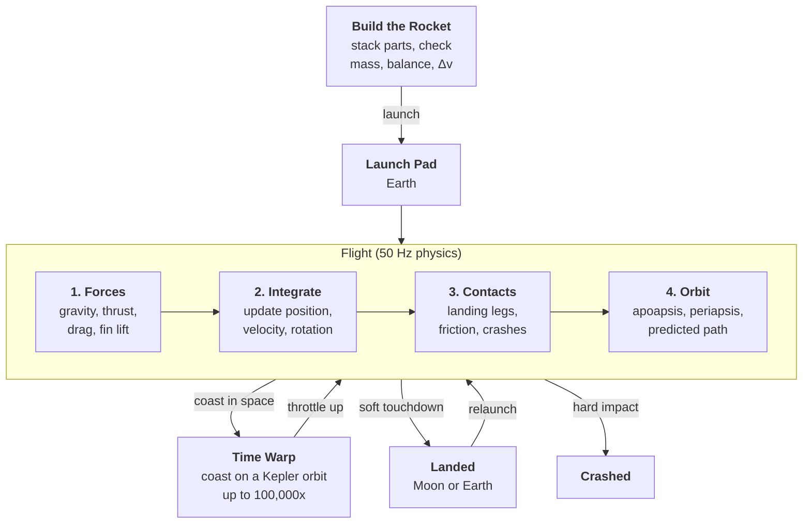

# Tenth Scale

A rocket-building and spaceflight simulator in a 1:10 scale Solar System, by Luke Hinojosa and Calvin Williams for GPR-350 Game Physics.

The player builds a rocket from parts (command pod, fuel tanks, engines, decouplers, fins, parachutes, landing legs), launches it from Earth, reaches orbit, and flies to and lands on the Moon. Every planet and moon is one tenth of its real size and distance but keeps its real surface gravity, so orbit takes about 2.4 km/s instead of 7.8 km/s and missions stay short enough to play.

**Status:** the project is set up from [CppTemplate](https://github.com/lukehinojosa/CppTemplate) and builds on Windows and for the web. The three modules and the shared interface are in place, with a placeholder Solar System and a point-mass rocket under gravity. The game opens on the build screen, where parts are dragged from the list on the left onto the build plate and stacked onto a command pod (with undo); Launch goes to a placeholder flight screen. **In the browser:** [the latest build](https://lukarbonite.dev/TenthScale/), published from `main` by CI once both builds pass.

**Final demo (due December 10):** one full mission. Build, launch, reach orbit, burn toward the Moon, and land.

## Getting started

Windows 10/11, from the repo folder in File Explorer:

| File | What it does |
| --- | --- |
| `install.bat` | Installs whatever is missing (Git, CMake, Ninja, Python, the MSVC build tools, emsdk). Run once; safe to re-run. Nothing needs restarting afterwards. |
| `run.bat` | Builds the game and starts it. The first build downloads and compiles the libraries (several minutes, once). |
| `run-web.bat` | Builds the browser version and opens it at http://localhost:8080. Closing the window stops the server. |

## Modules

The work is split so neither person waits on the other.

| Module | Contents | Owner |
| --- | --- | --- |
| Rocket and Flight | Rocket physics, engines, aerodynamics, steering, landing, staging, the build screen, and the flight HUD | Luke |
| Solar System | Planet and moon data, their orbits, sphere-of-influence checks | Calvin |
| Shared | Time warp, the map view, main loop and timestep, camera, tests, and the final demo | Both |

The modules meet at one small interface, `SolarSystem` in `app/src/shared/SolarSystem.h`: the Solar System answers "where is this planet at time t?" (`positionAt`, `velocityAt`) and "whose gravity is this rocket in?" (`dominantBody`). Positions are metres from the Sun, times are seconds since the mission started. `CircularSolarSystem` stands in until the real Kepler orbits are done, so rocket work isn't blocked; the real one replaces it behind the same interface.

## Game flow



<details>
<summary><b>Physics systems</b></summary>

- **Rigid-body rocket:** all parts act as one rigid body whose mass, center of mass, and inertia are recomputed as fuel burns and stages drop. Off-center thrust or drag creates torque, so a badly built rocket tumbles.
- **Gravity:** inverse-square gravity from the dominant body, switching between Earth and the Moon at their spheres of influence (patched conics).
- **Engines and fuel:** thrust that weakens in thick air, fuel burn that lightens the rocket, and Δv per stage from the rocket equation.
- **Atmosphere and drag:** air density that falls with altitude, drag on every part, and lift on fins, which keeps a finned rocket pointed forward.
- **Steering:** reaction wheels and swiveling engines apply torque, and a PD controller can hold the rocket's heading.
- **Integration:** a fixed 50 Hz timestep with semi-implicit Euler and double-precision positions, since a Solar System is too large for 32-bit floats.
- **Orbits and time warp:** a coasting rocket follows its orbit exactly by solving Kepler's equation, so time can speed up to 100,000x without drifting.
- **Landing and staging:** contacts with friction for touchdowns, crashes when impacts are too hard, and separated stages that keep their momentum.

</details>

<details>
<summary><b>Timeline</b></summary>

| Week of | Rocket and Flight | Solar System |
| --- | --- | --- |
| Nov 9 | Shared setup: main loop, 50 Hz timestep, camera. The rocket as one rigid body. | Planet and moon data at 1:10 scale. Agree on the interface; placeholder orbits. |
| Nov 16 | Engines, fuel burn, staging, the atmosphere, and drag. | Kepler orbits, gravity from the dominant body, and sphere-of-influence switching. |
| Nov 23 | Steering, the PD controller, fin lift, and the build screen. | Shared: time warp and the map view. |
| Nov 30 | Landing, crashes, and the flight HUD. First launch to orbit. | Real orbits replace the placeholder. First trip from Earth to the Moon. |
| Dec 7 | Both: bug fixes, tuning, tests, and the final demo. Due Thursday, December 10. | |

</details>

## Layout

| Folder | Contents |
| --- | --- |
| `app/src/` | The game: `Game.cpp` runs the scene and ties the modules together |
| `app/src/shared/` | Shared module: `SolarSystem.h` (the interface between the modules), `Vec3d.h` (double-precision vectors), `Scene.h` (one screen of the game), and `OrbitCamera` |
| `app/src/solar/` | Solar System module: `CircularSolarSystem` is the placeholder with the Sun, Earth, and the Moon on circular orbits |
| `app/src/flight/` | Rocket and Flight module: `Rocket` flies relative to whichever body's gravity it's in; `PartCatalog` and `RocketDesign` hold the parts and a rocket built from them; `BuildScene` and `FlightScene` are the build and flight screens |
| `app/assets/` | Images and sounds, loaded as `"assets/name.png"` |
| `app/config/` | Runtime settings in `game.yaml`; changes apply without a rebuild |
| `examples/sandbox/` | A demo of every library from the template: lighting and shadows, terrain, the physics playground, audio. Reference for how to use each one. |
| `libs/cyclone/` | Cyclone physics (Millington, *Game Physics Engine Development*) |
| `libs/engine/` | The game loop, rendering, lighting, audio, input, animation |
| `libs/core/` | Events, components, memory pools, config, timers |
| `libs/ai/`, `net/`, `gpu/` | Game AI, networking, WebGPU compute (optional) |
| `libs/vendor/` | Third-party code: raylib, Dear ImGui, rlImGui, FastNoiseLite |
| `tests/` | Unit tests for every library |
| `server/` | The WebSocket relay server |
| `tools/` | The install script |

## Working together

- Pull before starting work, so the partner's latest changes are included.
- Commit small, self-contained changes with a message saying what changed.
- Push once the project builds and runs.
- Keep to your own module's files where possible; changes to the shared interface are agreed on first.
- A conflict means both people changed the same lines; resolve it together rather than discarding either side.
- `build/` and `.cpm-cache/` are build output and are ignored by git.

<details>
<summary><b>Troubleshooting</b></summary>

- **"was not found" or "emsdk was not found":** a tool is missing or failed to install. `install.bat` lists what is still missing.
- **The first build seems stuck:** it is downloading and compiling the networking libraries; allow up to 10 minutes.
- **A build fails:** the last red lines in the window name the step and the error. `install.bat` reports anything still missing.
- **The browser page is blank:** refresh once the window says "Serving".

</details>

<details>
<summary><b>Command line</b></summary>

From PowerShell in the repo root:

| Command | What it does |
| --- | --- |
| `.\build.ps1` | Debug build, then the unit tests |
| `.\build.ps1 -Run` | Also starts the game |
| `.\build.ps1 -Run -Sandbox` | Starts the sandbox example instead |
| `.\build.ps1 -Config Release` | Release build |
| `.\build.ps1 -SkipTests` | Skips the unit tests |
| `.\build.ps1 -Web -Run` | Browser build, served on :8080 |
| `.\build.ps1 -GpuCompute` | Also builds libs/gpu (WebGPU compute); stays on until set OFF |
| `.\tools\install-windows.ps1 -CheckOnly` | Reports what's installed without changing anything |
| `.\tools\install-windows.ps1 -NoWeb` | Installs everything except emsdk (desktop builds only) |

</details>

<details>
<summary><b>CLion</b></summary>

Open the folder and enable the `Windows Debug`, `Windows Release`, or `Web` profile when CLion offers the presets. They use CLion's bundled Ninja and its default "Visual Studio" toolchain, and share build folders with `build.ps1`, so the libraries are only compiled once.

</details>

<details>
<summary><b>Linux (Ubuntu 24.04)</b></summary>

```bash
sudo apt install build-essential cmake ninja-build git libx11-dev libxrandr-dev libxinerama-dev libxcursor-dev libxi-dev libgl1-mesa-dev
```

```bash
cmake --preset release && cmake --build --preset release && ctest --preset release
```

</details>

<details>
<summary><b>Sources</b></summary>

1. Millington, I. (2010). *Game Physics Engine Development* (2nd ed.). CRC Press. Companion code: [Cyclone](https://github.com/idmillington/cyclone-physics). The basis for the rocket's rigid-body model, fins, and landing contacts.
2. Fiedler, G. (2004). [Fix Your Timestep!](https://gafferongames.com/post/fix_your_timestep/) Gaffer On Games. The fixed 50 Hz physics loop and interpolated rendering.
3. Schwarz, R. (2017). [Keplerian Orbit Elements to Cartesian State Vectors and back](https://www.rene-schwarz.com/web/Science/Memorandum_Series). Memorandum Series. The orbit display, predicted path, and time warp.
4. Kaufmann, L. S., Franzin, F. P., Menegais, R., and Pozzer, C. T. (2021). [Accurate real-time physics simulation for large worlds](https://www.scitepress.org/Papers/2021/101945/101945.pdf). GRAPP 2021, 135 to 142. Double-precision positions and camera-relative rendering.
5. NASA Glenn Research Center. [Earth Atmosphere Model](https://www.grc.nasa.gov/www/k-12/airplane/atmosmet.html) and [Thrust Equations Summary](https://www1.grc.nasa.gov/beginners-guide-to-aeronautics/thrust-equations-summary/). How drag and engine thrust change with altitude.

</details>

<details>
<summary><b>Licenses</b></summary>

Vendored and downloaded libraries keep their own licenses: raylib (zlib), Dear ImGui and rlImGui (MIT), FastNoiseLite (MIT), Asio (Boost), nlohmann_json (MIT), yaml-cpp (MIT), doctest (MIT), MbedTLS (Apache-2.0), libdatachannel (MPL-2.0).

</details>
